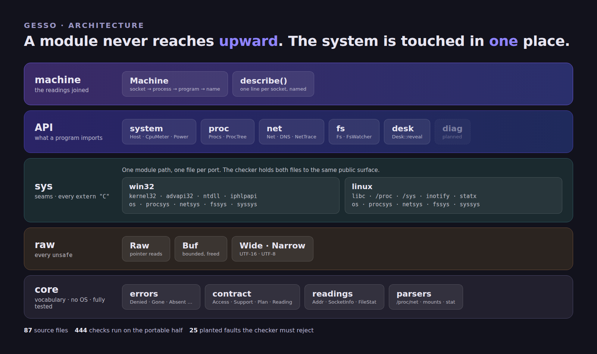
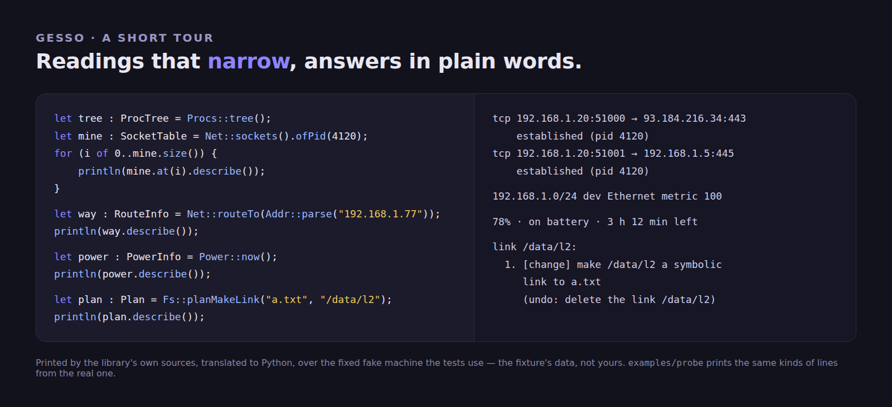
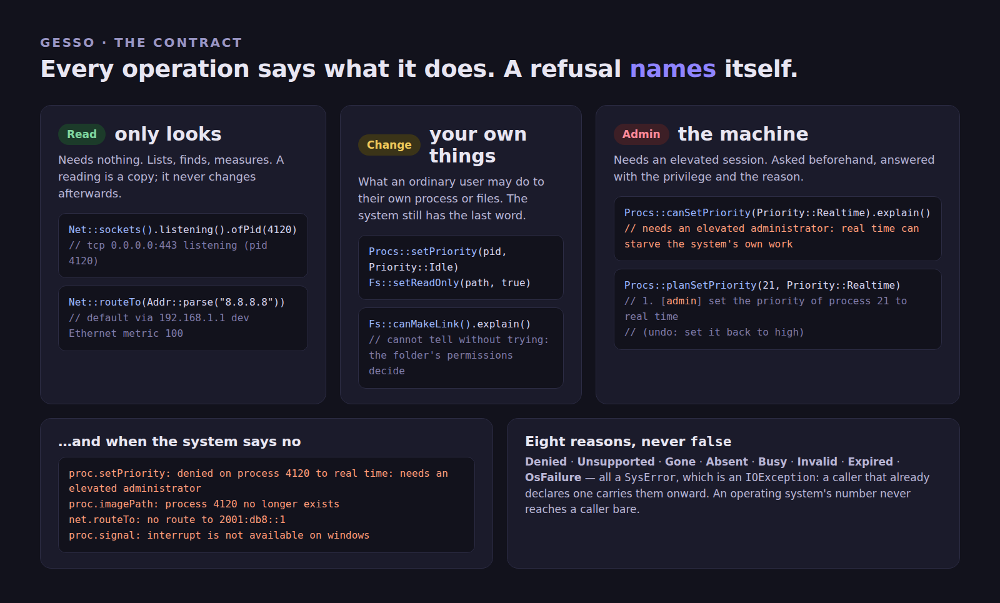

<div align="center">

# 🎨 gesso

### What an operating system exposes — processes, network, files, power — as **one library**, written once, for [**Axle**](https://axle-lang.dev)

**Not a pile of bindings.** Every program that watches a machine ends up writing the same page of `extern "C"`, the same record whose offsets were read off a header, and an error number that means something different on each platform. Gesso is that layer, once: readings that are plain data, refusals that name themselves, and one tree that builds for Windows and Linux.

<p align="center">
  <a href="https://axle-lang.dev"></a>
  <a href="https://github.com/Axle-lang/smalt"></a>
</p>
<p align="center">
  
  
  
  
  
</p>



<sub>The layers, and the one place the system is touched. Every number in the footer is a thing the tools in <code>tools/</code> run.</sub>

<br>

<sub><a href="#-at-a-glance">At a glance</a> · <a href="#-highlights">Highlights</a> · <a href="#-quick-start">Quick start</a> · <a href="#-the-modules">Modules</a> · <a href="#-the-contract">Contract</a> · <a href="#-honest-status">Status</a> · <a href="doc/ARCHITECTURE.md">Architecture</a> · <a href="doc/CONTRACT.md">Contract doc</a> · <a href="doc/ROADMAP.md">Roadmap</a> · <a href="LIMITATIONS.md">Limitations</a> · <a href="https://axle-lang.dev">Axle ↗</a></sub>

</div>

---

> **gesso** *(n.)* — the ground coat a painter lays on the panel before any paint: chalk and glue, the
> thing between the picture and the wood.
> That is the whole library. [smalt](https://github.com/Axle-lang/smalt) is the pigment and
> [zaffre](https://github.com/Axle-lang/zaffre) the picture; gesso is what they are painted on — the
> machine.

> **Status.** The portable half — parsers, tables, arithmetic, the whole API — is run, 444 checks, over fixed
> fake machines. The half that touches the operating system (`raw/` and `sys/`) can only be proved on one:
> `axle check` is the last word, `examples/probe` is the first program to run, and
> [`LIMITATIONS.md`](LIMITATIONS.md) lists, one by one, what is proven, what is only checked, and which
> record offsets have never met a machine.

## 📊 At a glance

| | |
|---|---|
| **Language** | 100% [Axle](https://axle-lang.dev) — no C, no vendored library, no `[link]` section: each OS library is named by the `extern "C" from "…"` block that imports from it |
| **Platforms** | Windows x86-64 (`kernel32`, `advapi32`, `ntdll`, `iphlpapi`) and Linux x86-64 (`libc`, `/proc`, `/sys`, inotify, `statx`) — one source tree, the target picks the files. macOS and Android are not served: nothing here can test them, and a promise that cannot be kept is worse than none |
| **Scope** | The processes, the network, the files and the power of a machine — what a monitor, a task manager or an installer reads. Processes, sockets with their owner, interfaces, routes, volumes, folders, a folder watcher, processor load and battery today; the desktop and diagnostics next |
| **Readings** | Plain data. A `ProcInfo`, a `SocketInfo`, a `FileStat` is a copy of what the system said at one moment; it never changes afterwards, and carries a `key` that finds the same thing again in the next reading |
| **Failure** | Every refusal is a `SysError` — an `IOException`, so a caller already declaring one carries it onward — and the most precise of eight reasons: `Denied` names the privilege it lacked, `Gone` and `Absent` say which, `Unsupported` says where. An OS number never reaches a caller bare, and nothing returns `false` for "the system said no" |
| **Asking first** | Every `Change` and `Admin` operation has a `can…` that answers *yes*, *yes with this privilege*, *not here* or *cannot tell*, and a `plan…` that says what it would do and how to put it back — before it does anything |
| **Portability** | A seam is one module path with one file per port. `tools/check.py` holds both files to the same public surface, keeps `extern "C"` inside `sys/<port>/` and `unsafe` inside `raw/`, and refuses a shared file that imports a module only one port has |
| **Verification** | What cannot run without a machine is separated from what can: the portable half — parsers, tables, arithmetic, the whole API — is translated to Python and run, 444 checks, over fixed fake machines |
| **Known limits** | All of them, with what each would take to lift: [`LIMITATIONS.md`](LIMITATIONS.md) |

## ✨ Highlights

- 🌳 **Processes as the tree they are** — `Procs::tree()` lays the list out depth first. A parent that has exited, an id the system reused for a younger process, a process that names itself, a loop of parents: all become roots, never a lie about the shape.
- 🔌 **Sockets that know their owner** — Windows answers with one call per table; on Linux the owner is found by searching every process's open files for the socket's inode, and a socket whose process the system will not show reads `pid` −1 but still names its **user** (`uid`), stays in the table (`withoutOwner()`), and makes `Net::socketsStatus` say *partial*, with what would show the rest — a display shows it and does not drop it.
- 🧭 **Addresses that behave** — one `Addr` for IPv4 and IPv6: parse any written form, print RFC 5952, `kind()` (private, loopback, link-local, public…), `inSubnet()`, and an IPv4-mapped IPv6 address equals its IPv4 twin.
- 🔎 **Tables that narrow** — `Net::sockets().listening().ofPid(4120).external()`: each step is a new table of copied rows, so tables never share state and any of them may be kept.
- 🗺️ **Routing that answers like the system** — `Net::routeTo(addr)` takes the longest prefix and, among equals, the lowest metric. `Net::primary()`, `gateway()`, `localAddress()`, `isOnline()` are built on it.
- 📈 **Rates, not just counters** — `TrafficMeter` turns two readings into bytes per second, and treats a counter that went *down* as no measurement rather than a gigabyte per second. `CpuMeter` does the same for processor load.
- 🏷️ **Names, from what the machine asked for** — a reverse record says what an address's *owner* published, which for a content network is a machine number. The resolver's own cache says what a program on this machine *typed*: `Net::dnsCache().nameOf(addr)` is `api.stripe.com`, not `a23-45-67-89.deploy.akamaitechnologies.com`. Nothing is sent to the network to read it.
- 🌐 **Who announces an address** — `Net::origin(addr)` is two DNS lookups against Team Cymru's zones, no key and no TLS: `AS15133 EDGECAST, US`. `Net::reverse` and `Net::txt` are the lookups under it, read from the DNS message itself by a parser that follows name pointers, refuses a message that points at itself and never reads past its own length.
- 📡 **A live trace** — `NetTrace::start()` opens an Event Tracing session on the kernel's network provider and the DNS client's: `poll()` takes what has happened since last time and `counters()` answers *bytes sent and received by this process*, the connections that opened and closed between two polls, and the names it resolved. Events collect in a ring while the program does other things; the trace says when it dropped some.
- 🚦 **A reading says whether it is running** — `ReadingStatus` is `On`, `Off` (with the privilege that would lift it) or `Lost`, with a sentence. A traffic column that is empty because nothing was sent and one that is empty because nothing measures it must not look alike.
- 🔗 **The join, once** — `Machine` joins what `proc`, `net` and `desk` each read by number: `machine.describe(socket)` is `tcp 10.0.0.2:51000 → api.stripe.com:443 established — chrome.exe [4120]`. Programs are looked up once and remembered by process *identity*, so a reused id is a miss and never the old answer.
- 📁 **Files, with the parts `std` leaves out** — the volumes and the room left on each, a folder with the kind of every entry, a link *as a link*, a recursive size that never follows one, and a watcher whose queue is first-in first-out and says so when the system dropped events (`WatchState::Lost`) instead of guessing.
- 🔒 **Privilege is part of the vocabulary** — `Access` is `Read`, `Change` or `Admin`; `Privilege` is `User`, `Elevated` or `System`; the process knows which it holds (the token on Windows, the effective user on Linux) and refuses early, while the system keeps the last word.
- 🧪 **A checker, because there is no compiler here** — a parser written from the language's documentation, a resolver for names and arities, the layer and port rules, and a self-test that plants 25 faults and fails if any is accepted.

## 🚀 Quick start

```toml
# your-program/axle.toml
[package]
name = "your-program"

[dependencies]
gesso = { path = "../gesso" }
```

```rs
use gesso::{Net, Procs, Fs, Host, SocketTable, SocketInfo, ProcInfo, SpaceInfo, Bytes, SysError, Addr, RouteInfo};

// `main` is the only place errors stop: every call below says what it can raise.
fn main() : i32 {
    try {
        let me : i64 = Host::info().pid;

        // What is this program talking to?
        let mine : SocketTable = Net::sockets().ofPid(me).external();
        for (i of 0..mine.size()) {
            println(mine.at(i).describe());
        }

        // And which way does the internet go from here?
        let way : RouteInfo = Net::routeTo(Addr::parse("8.8.8.8"));
        println(way.describe());

        // How full is the disk it lives on?
        let disk : SpaceInfo = Fs::space(Procs::imagePath(me));
        println(Bytes::human(disk.unused) + " free of " + Bytes::human(disk.total));
        return 0;
    } catch e : SysError {
        println(e.message);        // "proc.imagePath: denied on process 4: needs an elevated administrator"
        return 1;
    }
}
```

That is the whole setup: no DLL to copy, no prefix to find. Build `examples/probe` first on a new machine — it reads
every part of the library once, prints it, and when the system refuses a reading it prints *why* and goes on to the next:

```bash
cd examples/probe
axle build && ./target/probe
```

<div align="center"></div>

## 🧩 The modules

| Module | For | Status |
|---|---|---|
| `core` | errors, privileges, support, plans, keys, time, units, addresses, readings, parsers, watchers | written, **run** through the translated tests |
| `raw` | pointer reads, bounded buffers, UTF-16 and UTF-8, socket addresses | written, not run |
| `system` | host, memory, uptime, processor load, battery | both ports written, not run |
| `proc` | the process list and tree, image path, priority, signals | both ports written, not run |
| `net` | sockets with their owner, interfaces, routes, traffic rates, **the resolver's cache inverted** (address → the name a program asked for), PTR and TXT lookups, **the network that announces an address**, **a live trace** (bytes per process, short connections, resolved names) | reading written on both ports, the polled tables run on Windows; the DNS and trace parts are not run. *Changing* the network (routes, DNS) is held back until the reading has met a machine |
| `fs` | volumes, free space, folder listing, links, read-only, a folder watcher | both ports written; the Windows ones run |
| `desk` | **revealing a file in the file manager**; notifications, clipboard, hotkeys, windows, the session next | `reveal` written on both ports, not run |
| `machine` | **the readings joined**: a socket's process, a process's program (found once, remembered), an address's name | written; tested over fake machines |
| `diag` | event log, journal, crash reports, counters | planned |

The order, and why, is in [`doc/ROADMAP.md`](doc/ROADMAP.md).

## 📜 The contract

Every public operation says what it does to the machine, and refuses precisely when the system says no.
Read it as three kinds of operation, and the one place a refusal can come from.

<div align="center"></div>

The full text — the five promises, what a `Plan` is, why a guard is a courtesy and the system still decides —
is [`doc/CONTRACT.md`](doc/CONTRACT.md).

## 🏛️ Architecture

Layers, bottom to top. **A module never reaches upward, and the API modules never see one another.**

```
   api      system · proc · net · fs · (desk · diag)       what a program imports
   sys      one seam per concern, one file per port        every extern "C", and only here
              win32/  kernel32 · advapi32 · ntdll · iphlpapi
              linux/  libc · files (/proc, /sys)
   raw      Raw · Buf · Wide · Narrow                      every unsafe, and only here
   core     errors · contract · readings · parsers         the vocabulary; no OS, fully tested
```

**How one tree builds for two systems.** There is no `#[cfg]` in Axle and none here. `axle.toml` declares the
ports — a condition and the directories that carry it — and a module path resolves to the file of whichever
port is active:

```toml
[port.win32]
when = { os = "windows" }
dirs = ["win32"]

[port.linux]
when = { os = "linux" }
dirs = ["linux"]
```

`src/sys/win32/netsys.axle` and `src/sys/linux/netsys.axle` are both `crate::sys::netsys`. Nothing above `sys/`
names an operating system, and the checker holds the sentence: it compares the two files' public classes and
signatures, so a target with a missing answer fails *here*, not in a build far from the cause.
[`doc/ARCHITECTURE.md`](doc/ARCHITECTURE.md) has the layers, how a seam is written and how to add an operation.

## 🔬 Honest status

`axle` is the compiler's word, and the OS-facing files only meet a machine when a program runs. What stands in for them runs beside it:

| Tool | What it holds |
|---|---|
| `tools/check.py` | every file parses; names, arities, mutability and exhaustiveness resolve; layers never reach upward; `extern "C"` only in ports, `unsafe` only in `raw/`; every port answers a seam alike; a shared file imports only what every port has |
| `tools/check.py --selftest` | plants 25 faults, one at a time, and fails if the checker accepts any |
| `tools/gen_lib.py --check` | `src/lib.axle` names every module a build must see |
| `tools/axpy/` | an Axle → Python translator that runs the portable half — 444 checks over fixed fake machines |

```bash
python3 tools/check.py
python3 tools/check.py --selftest
python3 tools/gen_lib.py --check
for t in core proc net fs system dns desk trace machine; do python3 tools/axpy/test_$t.py; done
python3 tools/axpy/live_linux.py   # the same parsers, on this machine's real /proc and /sys (Linux)
tools/img/render.sh            # the pictures above, from tools/img/*.html
```

What these *cannot* tell: that an operating-system call works, or that a record offset is right —
a wrong offset reads the wrong bytes without an error. The ones taken from a program known to work (netaudit's
socket tables) are marked as such; the rest are not, and [`LIMITATIONS.md`](LIMITATIONS.md) says which. If
`examples/probe` prints a nonsense number, that is where to look.

## 🗂️ Where things are

| | |
|---|---|
| `src/core/` | vocabulary and parsers — no operating system in it |
| `src/raw/` | the only `unsafe` |
| `src/sys/` | the seams: `win32/`, `linux/`, and `errno` which sorts an OS number into a reason |
| `src/system/` `proc/` `net/` `fs/` | the API |
| `examples/probe/` | reads everything once and prints it |
| `doc/` | [architecture](doc/ARCHITECTURE.md) · [contract](doc/CONTRACT.md) · [roadmap](doc/ROADMAP.md) · `img/` |
| `tools/` | the checker, the translator, the tests, the picture source |

## License

MIT.
